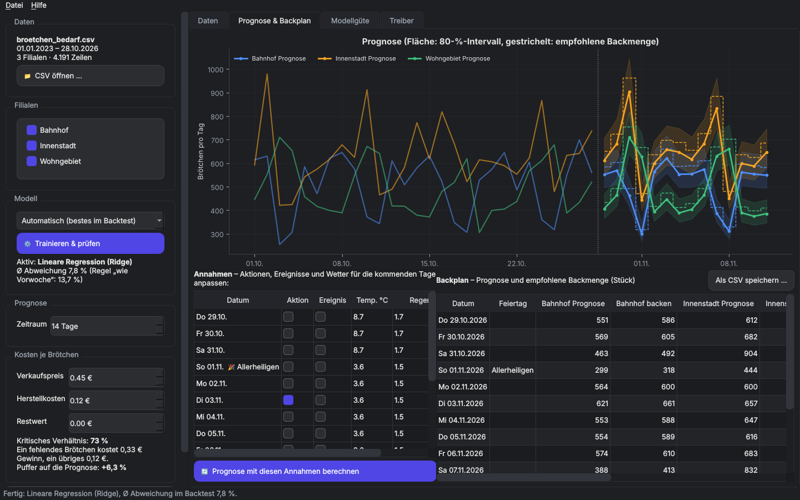
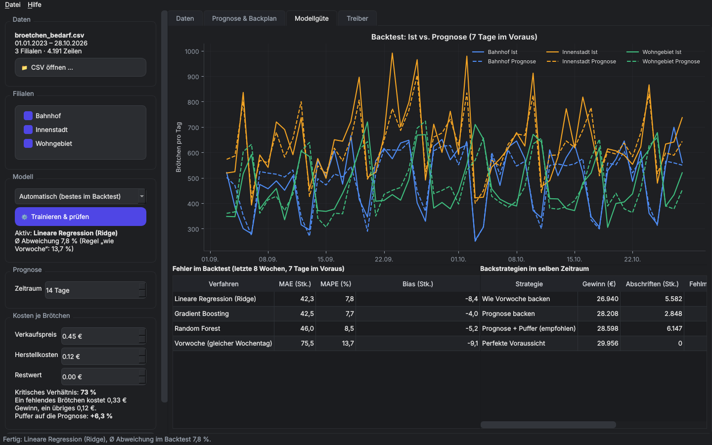
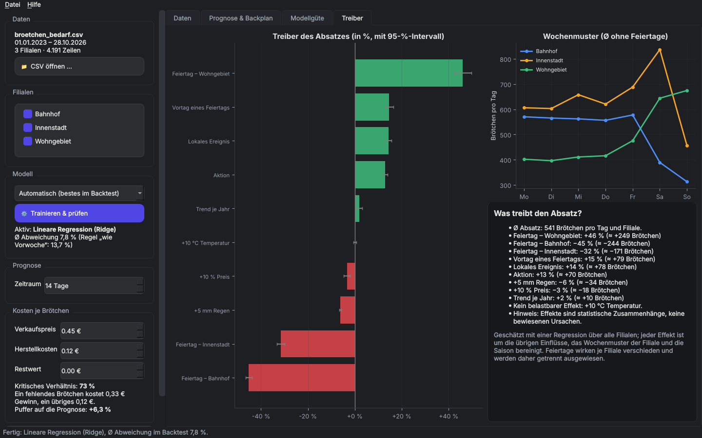

# Brötchen-Prognose

[](https://github.com/tobias-weiss-analytics/broetchen-prognose/actions/workflows/ci.yml)

Eine Desktop-App für Bäckereien: Sie sagt den Brötchenabsatz je Filiale für die nächsten Tage voraus und empfiehlt die **gewinnoptimale Backmenge**. Gebaut mit Python, PySide6 (Qt) und scikit-learn; als Windows-`.exe` verteilbar.



## Hintergrund

Auf die Idee hat mich ein Fernsehbeitrag gebracht, der zeigte, wie Bäckereien mit Datenanalyse ihre Backmengen planen und so weniger Brötchen wegwerfen. Ich wollte ausprobieren, ob ich so etwas selbst bauen kann. Es ist mein erstes eigenes Programm mit grafischer Oberfläche, von der Datenaufbereitung über das Prognosemodell bis zur fertigen Windows-Anwendung.

## Die Frage dahinter

Backt eine Filiale zu wenig, gehen Verkäufe verloren. Backt sie zu viel, landen Brötchen im Abfall. Beides kostet Geld, aber unterschiedlich viel. Die App beantwortet deshalb zwei Fragen:

1. **Wie viele Brötchen werden voraussichtlich verkauft?**
   Eine Absatzprognose aus Wochentag, Feiertagen, Saison, Aktionen, lokalen Ereignissen, Wetter, Preis und dem jüngsten Verlauf.
2. **Wie viele sollten gebacken werden?**
   Die Prognose plus ein Puffer, der sich aus dem Verhältnis von entgangenem Gewinn zu Abschriftkosten ergibt (Newsvendor-Modell).

## Funktionen

- **Sofort startklar:** Beim Start werden Demo-Daten geladen, das Modell trainiert und die nächsten 14 Tage prognostiziert. Das Training läuft im Hintergrund.
- **Prognose & Backplan:** Bis zu 28 Tage im Voraus, mit 80-%-Intervall. Gesetzliche Feiertage (Bayern) werden automatisch erkannt. Aktionen, Ereignisse und Wetter lassen sich je Tag anpassen, z. B. „Was, wenn am Dienstag eine Aktion läuft?“. Export als CSV für Excel.
- **Kosten:** Preis, Herstellkosten und Restwert eines Brötchens einstellen; Empfehlung und Strategievergleich passen sich sofort an.
- **Modellgüte:** Gradient Boosting, Random Forest und lineare Regression treten in einem ehrlichen Backtest gegen die Faustregel „wie Vorwoche“ an. Das beste Verfahren wird automatisch gewählt.
- **Treiber:** Welche Faktoren den Absatz um wie viel Prozent verändern, bereinigt um alle übrigen Einflüsse; dazu das Wochenmuster jeder Filiale.
- **Eigene Daten:** CSV öffnen; gängige Spaltennamen werden erkannt, Lücken aufgefüllt, Fehler verständlich gemeldet.
- **PDF-Report:** Prognose, Backplan, Modellgüte, Strategievergleich und Treiber.

| Modellgüte | Treiber |
|---|---|
|  |  |

## Demo-Daten

Die mitgelieferten Daten sind **simuliert**, folgen aber einem realistischen Muster: eine Bäckerei mit drei Filialen in einer niederbayerischen Kleinstadt, Januar 2023 bis Oktober 2026. Erzeugt werden sie von [`scripts/generate_demo_data.py`](scripts/generate_demo_data.py).

| Filiale | Profil |
|---|---|
| Innenstadt | stärkster Tag Samstag (Einkaufsbummel), Dult und Stadtfeste bringen viel Laufkundschaft |
| Bahnhof | Pendler: werktags stark, am Wochenende und an Feiertagen schwach, Einbruch in den Sommerferien |
| Wohngebiet | Familien: Wochenende und Feiertage am stärksten |

Dazu kommen Wetter mit Jahresgang (Juli Ø 20 °C, Januar Ø −2 °C), bayerische Feiertage samt Vortageseffekt, Preiserhöhungen von 0,35 € auf 0,45 €, Aktionen an schwachen Tagen, Weihnachtsgeschäft und Zufallsschwankungen.

### Nachweis, dass die Analyse funktioniert

Weil die Effekte in den Demo-Daten bekannt sind, lässt sich prüfen, ob die App sie wiederfindet. Sie kennt nur die Verkaufszahlen, nicht den Generator:

| Effekt | eingebaut | von der App geschätzt (95-%-Intervall) |
|---|---|---|
| Aktion | +12 % | +12,9 % (+11,8 bis +14,0) |
| Vortag eines Feiertags | +15 % | +14,7 % (+12,9 bis +16,4) |
| +5 mm Regen | −5,9 % | −6,2 % (−6,6 bis −5,8) |
| +10 % Preis | −3,7 % | −3,3 % (−4,7 bis −2,0) |
| Trend je Jahr | +2 % | +1,8 % (+0,6 bis +3,1) |
| Temperatur (nur Hitze über 26 °C) | ≈ 0 | 0,0 % |

Alle eingebauten Werte liegen in den geschätzten Intervallen. Ein automatischer Test (`tests/test_demo_data.py`) prüft das bei jeder Änderung.

## Ergebnisse mit den Demo-Daten

Backtest über die letzten 8 Wochen (September/Oktober 2026 mit Herbstdult und Tag der Deutschen Einheit), jeweils 7 Tage im Voraus prognostiziert:

| Verfahren | Ø Abweichung (MAPE) |
|---|---|
| Faustregel „wie Vorwoche“ | 13,7 % |
| Random Forest | 8,5 % |
| Gradient Boosting | 7,7 % |
| **Lineare Regression (gewählt, geringster absoluter Fehler)** | **7,8 %** |

Bei 0,45 € Verkaufspreis und 0,12 € Herstellkosten ergibt sich ein kritisches Verhältnis von 73 %, also ein Puffer von etwa +6 % auf die Prognose. Ergebnis im Backtest-Zeitraum, drei Filialen:

| Backstrategie | Gewinn | Abschriften | Tage ausverkauft |
|---|---|---|---|
| Wie Vorwoche backen | 26.940 € | 5.582 Stk. | 52 % |
| Prognose backen | 28.208 € | 2.848 Stk. | 55 % |
| **Prognose + Puffer (empfohlen)** | **28.598 €** | 6.147 Stk. | **27 %** |
| Perfekte Voraussicht (Obergrenze) | 29.956 € | 0 Stk. | 0 % |

Die empfohlene Strategie schließt gut die Hälfte der Lücke zwischen Faustregel und perfekter Voraussicht. Bemerkenswert ist der Zielkonflikt: Den höchsten Gewinn bringt nicht die Strategie mit den wenigsten Abschriften. Bei 33 Cent Marge und 12 Cent Kosten lohnt es sich, eher etwas zu viel zu backen.

## Methodik

- **Merkmale:** Filiale × Tagestyp (Wochentag oder Feiertag), Vortag eines Feiertags, Saison, Preis, Aktion, Ereignis, Temperatur, Regen sowie der Absatz vor 7 und 14 Tagen und die gleitenden Mittel der letzten 7 und 28 Tage. Verlaufsmerkmale verwenden ausschließlich Tage *vor* dem Zieltag; ein Test stellt das sicher.
- **Rekursive Prognose:** Für mehrere Tage im Voraus wird Tag für Tag prognostiziert. Jede Prognose dient als Verlaufswert für die folgenden Tage, genau wie im echten Einsatz.
- **Backtest:** Das Modell kennt nur Daten vor dem Testzeitraum. Ab jedem Wochenbeginn der letzten 8 Wochen wird 7 Tage im Voraus prognostiziert.
- **Backmenge:** Das Verhältnis Ist/Prognose aus dem Backtest beschreibt die Prognoseunsicherheit. Die empfohlene Menge ist die Prognose mal dem Quantil dieses Verhältnisses beim kritischen Verhältnis (Preis − Kosten) / (Preis − Restwert).
- **Treiber:** Regression des logarithmierten Absatzes auf alle Einflussgrößen gleichzeitig, mit dem Wochenmuster jeder Filiale und der Saison als Kontrollvariablen. Dadurch ist jeder Effekt als Prozentwert lesbar und um die übrigen Einflüsse bereinigt.

## Installation und Start

Benötigt Python 3.11+ und [uv](https://docs.astral.sh/uv/).

```bash
git clone https://github.com/tobias-weiss-analytics/broetchen-prognose.git
cd broetchen-prognose
uv sync
uv run python main.py                 # startet mit den Demo-Daten
uv run python main.py meine_daten.csv # oder mit eigener Datei
```

Ohne uv: `pip install -e .` und anschließend `python main.py`.

**Windows-Programm bauen:** `uv run pyinstaller BroetchenApp.spec` erzeugt `dist/BroetchenApp.exe`. Die `.exe` gehört nicht ins Repository, sondern als Download in ein [GitHub-Release](https://docs.github.com/de/repositories/releasing-projects-on-github/managing-releases-in-a-repository).

**Tests:** `uv run pytest` (Datenaufbereitung, Leckagefreiheit der Merkmale, Feiertage, Backtest, Backmengenlogik, Wiederfinden der Demo-Effekte, PDF-Export und ein Start der Oberfläche ohne Bildschirm).

## Eigene Daten

Eine Zeile je Tag und Filiale, Komma oder Semikolon als Trennzeichen:

| Spalte | Pflicht | Bedeutung |
|---|---|---|
| `date` | ja | Datum |
| `store` | ja | Filiale |
| `sales` | ja | verkaufte Brötchen |
| `price` | ja | Verkaufspreis |
| `temp_c` | ja | Tagestemperatur |
| `promo` | nein | 1 = Aktion |
| `event` | nein | 1 = lokales Ereignis (Markt, Fest …) |
| `rain_mm` | nein | Niederschlag |

Alternative Namen wie `store_id`, `sales_units`, `datum` oder `preis` werden erkannt. Mindestens 60 Tage je Filiale sind nötig. Die Feiertage gelten für Bayern; ein anderes Bundesland stellt man in `broetchen/data.py` über `REGION` ein.

## Projektstruktur

```
├── main.py                    # Startpunkt
├── broetchen/
│   ├── data.py                # Einlesen, Prüfen, Aufbereiten, Feiertage
│   ├── model.py               # Merkmale, Modelle, Backtest, rekursive Prognose
│   ├── planning.py            # Backmengen-Empfehlung (Newsvendor) und Strategievergleich
│   ├── insights.py            # Treiberanalyse und Wochenmuster
│   ├── charts.py              # Diagramme für App und Report
│   ├── report.py              # PDF-Report
│   ├── ui/                    # PySide6-Oberfläche
│   └── resources/             # Theme und Icon
├── scripts/generate_demo_data.py
├── data/broetchen_bedarf.csv  # Demo-Daten
├── tests/
└── BroetchenApp.spec          # PyInstaller-Konfiguration
```

## Grenzen

- Die Demo-Daten sind simuliert. Sie zeigen, dass die Methode funktioniert, ersetzen aber keinen Test mit echten Kassendaten.
- Verkaufszahlen unterschätzen die Nachfrage an ausverkauften Tagen (zensierte Nachfrage). Mit echten Daten sollte man solche Tage kennzeichnen.
- Für die Zukunft verwendet die App das saisonübliche Wetter, sofern man es nicht selbst einträgt. Eine angebundene Wettervorhersage wäre der nächste Schritt.
- Der Puffer wird aus demselben Backtest geschätzt, in dem die Strategien verglichen werden; der Gewinnvorteil ist daher leicht optimistisch.
